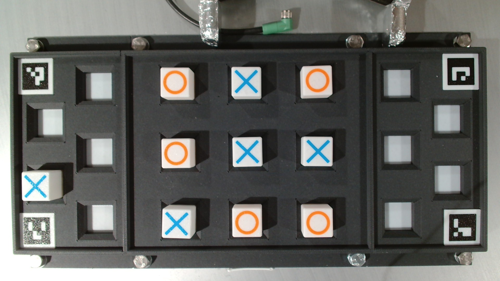
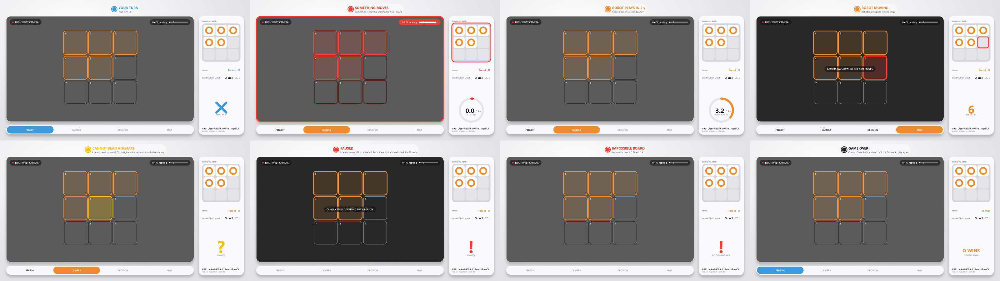

# UR3 tic-tac-toe with computer vision

A Universal Robots UR3 plays tic-tac-toe against a person. A webcam on the robot's wrist
reads the board, the program decides the move, and the arm places its piece. Then the
camera checks that the piece really landed on the right square.



## Results

Live games against people at the ASSAR lab (Högskolan i Skövde), November 2026,
from the game log [`robot/ur/partidas.csv`](robot/ur/partidas.csv):

- **8 games**: the robot won 4, drew 3 and lost 1.
- **37 of 41** pieces placed and confirmed by the camera. In the other 4, the robot
  stopped and asked a person for help instead of playing on.
- **About 24 s per robot move** (pick, carry, place and check).

## How it works

1. **See.** The camera (Logitech C920, 1920×1080 px) finds the 3×3 grid and reads each
   square by color: orange circle = O, blue cross = X, empty. If a square is unclear, or
   something is moving (a hand over the board), it waits instead of guessing.
2. **Decide.** The game rules pick the move: the robot plays O, the person plays X and
   starts. Two levels: `easy` and `hard` (never loses).
3. **Move.** After a short countdown, the PC sends URScript to the UR3 over the network:
   pick a block from the store, carry it, place it. A servo gripper on an Arduino closes
   and opens over USB.
4. **Check.** Back at the photo pose, the camera must see the new O on its square. If
   not, the robot stops and asks for help.

The board photo is always the truth, so the program can be stopped and restarted in the
middle of a game.

A live panel shows what the robot sees and thinks, for the audience:



## What is in this repository

| Folder | What it does |
| --- | --- |
| `vision/tictactoe/` | Board reader (OpenCV), game rules, camera helpers, color tuner. |
| `robot/ur/` | The director (plays the game), arm motion (URScript), gripper, live panel. |
| `calib/` | Lens calibration (chessboard) and board position (ArUco markers). |
| `datasets/` | Real photos from the wrist camera, with labels, used by the tests. |

## Run it

Python 3.13 on Windows:

```bash
pip install -r requirements.txt

# tests: no robot or camera needed
(cd vision/tictactoe && python -m unittest)
(cd robot/ur && python -m unittest)

# read a photo
(cd vision/tictactoe && python board_reader.py ../../datasets/tictactoe_c920_2026-11-11/lab_2026-11-11_cam_O_en_1-5.jpg)

# dry run: real camera, the arm and gripper only print
(cd robot/ur && python director.py --seco)
```

To play with the real robot, set the robot's IP and the taught positions in
`robot/ur/posiciones.json`, and the gripper's serial port with `--port`.

## Hardware

- Universal Robots UR3 (CB3, PolyScope 3.15), driven from a PC over Ethernet (port 30002).
- Logitech C920 webcam on a 3D-printed wrist mount.
- 3D-printed gripper with a hobby servo on an Arduino UNO R4 WiFi.

## Credits

- **Peru Mendivil** and **Joaquín Moreno**: vision, game logic, robot control and panel.
- The board, blocks, gripper and wrist mount were built in an earlier student project at
  ASSAR. Gripper firmware: [Hampusman/ArduinoGripper](https://github.com/Hampusman/ArduinoGripper).
- With the support and supervision of the robotics teacher at Högskolan i Skövde.

Some file and option names are in Spanish (for example `partidas.csv` = games log,
`posiciones.json` = positions, `--seco` = dry run).

## License

MIT, see [LICENSE](LICENSE).
